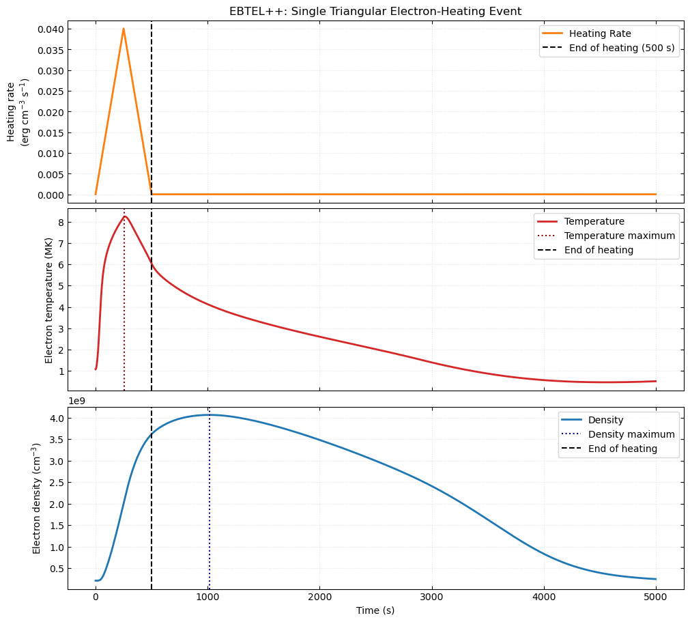
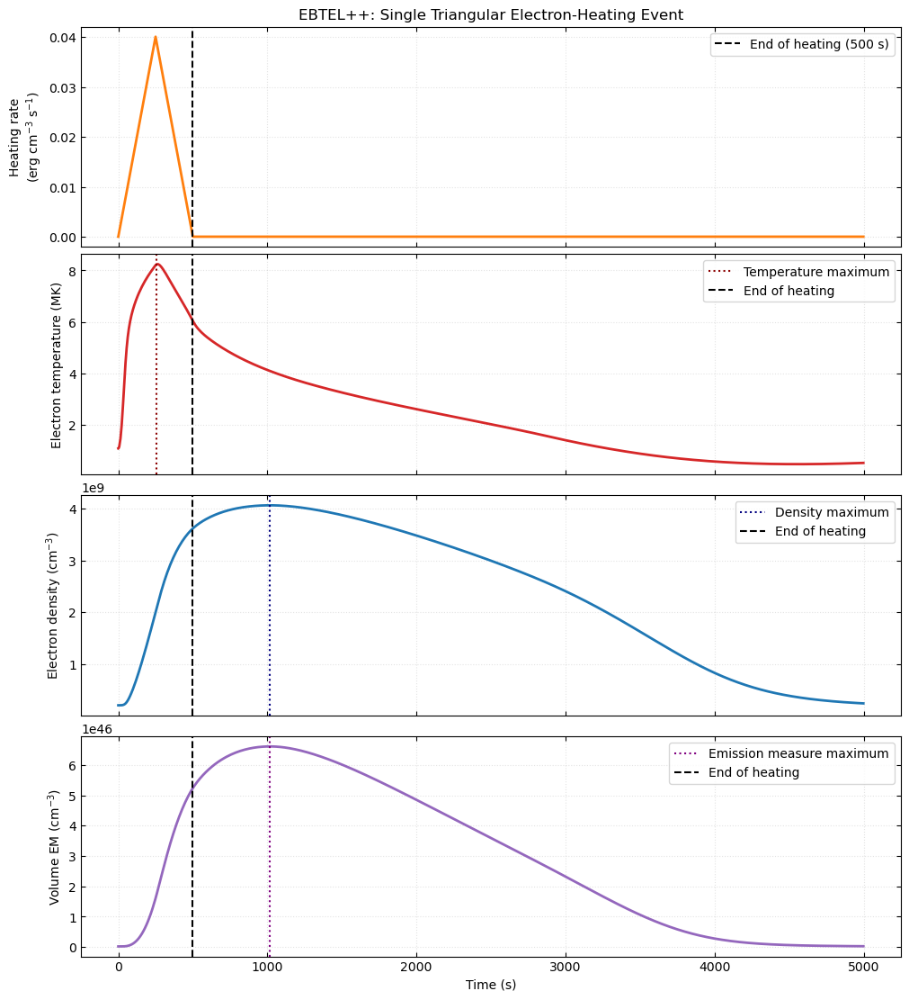
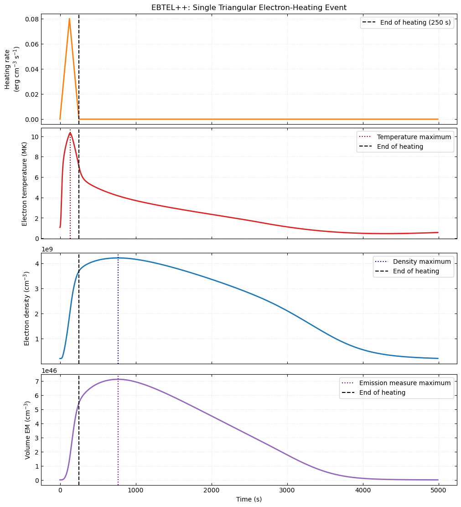
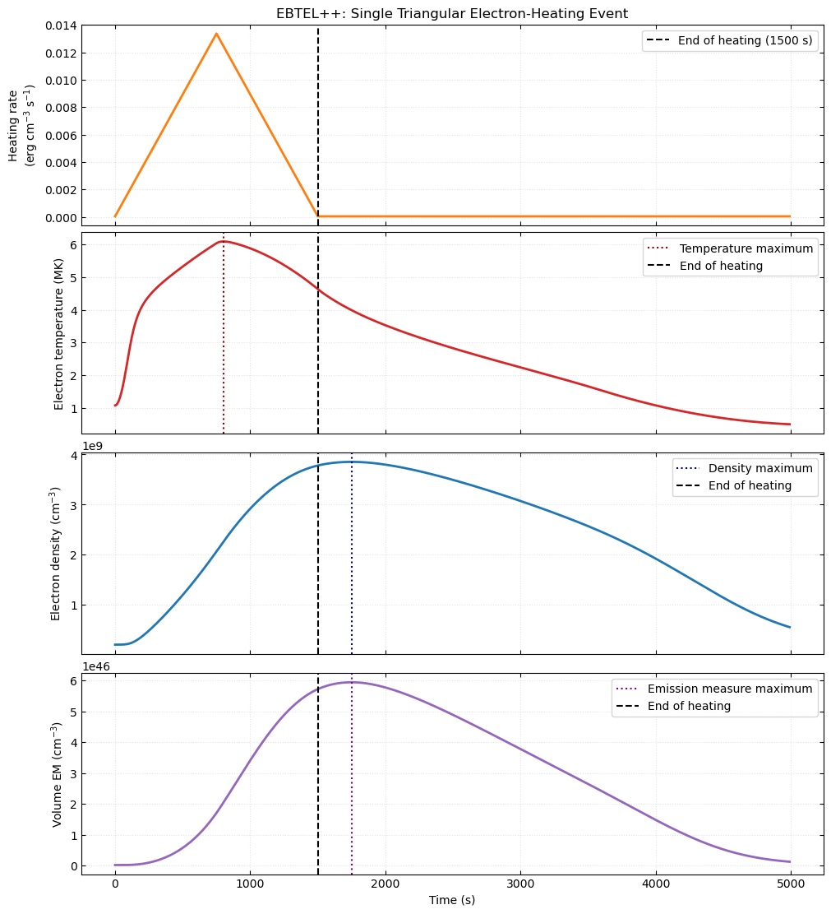

# Week 1
## Task Completed
1. Read the project scope and the introduction and conclusions of Klimchuk et al. (2008).
2. Created a dedicated Python environment with EBTEL++ and plotting tools.
3. Reproduce the one documented example, ran the unchanged single-event example: *Heating only the Electrons with One Triangular Event*.
4. Plotted the baseline heating rate, electron temperature and density.Recorded the model input parameters.
5. Tested heating durations of 0.5, 1 and 3 times the baseline duration (250, 500 and 1500 s).
6. Adjusted peak heating rates to maintain approximately constant integrated excess heating.
7. Calculated the volume emission measure. Plotted and compared temperature, density and emission measure for all three cases.

## Glossary
1. **Coronal Strand**:Strands are finer magnetic flux tubes that make up the unresolved structure. Each strands contain plasma and can have its own heating and cooling history. Many, if not all coronal loops are bundles of thin strands that are heated impulsively & Quasi-randomly by nanoflares.
2. **Thermal Conduction**:The transport of thermal energy along the magnetic field from hotter regions of the corona towards cooler lower atmosphere, particularly the transition region and chromosphere.
3. **Chromospheric Evaporation**: The upward flow of heated chromospheric plasma along magnetic loops into the corona, increasing coronal density in response to non-thermal energy deposition and downward conductive heating.
4. **Radiation**:The loss of plasma energy through electromagnetic emission. In an optically thin corona, the radiative loss rate depends on density and temperature.
5. **Enthalpy Flux**:The transport of energy associated with plasma flows between the corona and transition region. It is central to the EBTEL treatment of mass exchange.
6. **Emission Measure**:A measure of the amount of emitting plasma, weighted by the square of its electron density.
7. **Heating Rate**:The rate at which thermal energy is deposited per unit volume, expressed in \(\mathrm{erg\,cm^{-3}\,s^{-1}}\).
8. **Background Heating**:The persistent heating component used to maintain the pre-event or background coronal state.
9. **Thermal Draining(Condensation)**: The downward flow of coronal plasma towards the lower atmosphere as the loop cools and its pressure decreases.

## Reproducing the documented example
**Example 1: Heating only the electrons with one triangular event**

**Result**\
Loop Half Length: 40Mm\
Pulse shape: Triangular\
Background Heating: 3.50e-05 cm^-3 s^-1\
Pulse duration: 500s\
Peak Heating Rate: 0.04 erg cm^-3 s^-1\

**Model Output:**\
Temp. Maxima: 8.240Mk\
Temp. Maxima time: 258.3s\
Density Maxima: 4.066e+9 cm^-3\
Density Maxima Time: 1750s\
End of Heating: 500s\

## Heating Duration Changed
I took 500 second as the baseline duration from the above example, we now will find the temperature ,density, emission measure for 0.5,1,3 times baseline duration. which we get 250s, 500s,1500s.\
**Experiment 1: Baseline Duration**

**Result**\
Loop Half Length: 40Mm\
Pulse shape: Triangular\
Background Heating: 3.50e-05 cm^-3 s^-1\
Pulse duration: 500s\
Peak Heating Rate: 0.04 erg cm^-3 s^-1\

**Model Output:**\
Temp. Maxima: 8.240Mk\
Temp. Maxima time: 258.3s\
Density Maxima: 4.066e+9 cm^-3\
Density Maxima Time: 1750s\
End of Heating: 500s\

**Emission Measure**\
Assumed Width : 10Mm \
Cross sectional Area: 1e+18 cm^2\
Half loop volume : 4.00e+27 cm^3\
Maxima Volume EM: 5.940e+46 cm^-3\
Time of Maxima EM: 1750s\
Integrated Excess Heating: 9.9975 erg cm^-3\

**Experiment 2: Changing the duration to 250s**

**Result**\
Loop Half Length: 40Mm\
Pulse shape: Triangular\
Background Heating: 3.50e-05 cm^-3 s^-1\
Pulse duration: 250s\
Peak Heating Rate: 0.08 erg cm^-3 s^-1\
Heating Partition: 1.00\

**Model Output:**\
Temp. Maxima: 10.314Mk\
Temp. Maxima time: 135.0s\
Density Maxima: 4.216e+9 cm^-3\
Density Maxima Time: 770s\
End of Heating: 250s\

**Emission Measure**\
Assumed Width : 10Mm\ 
Cross sectional Area: 1e+18 cm^2\
Half loop volume : 4.00e+27 cm^3\
Maxima Volume EM: 7.110e+46 cm^-3\
Time of Maxima EM: 770s\
Integrated Excess Heating: 9.999 erg cm^-3\

**Experiment 3: Changing the heating duration to 1500s**

**Result**\
Loop Half Length: 40Mm\
Pulse shape: Triangular\
Background Heating: 3.50e-05 cm^-3 s^-1\
Pulse duration: 1500s\
Peak Heating Rate: 0.0133 erg cm^-3 s^-1\
Heating Partition: 1.00\

**Model Output:**\
Temp. Maxima: 6.088Mk\
Temp. Maxima time: 800.0s\
Density Maxima: 3.853e+9 cm^-3\
Density Maxima Time: 1750s\
End of Heating: 1500s\

**Emission Measure**\
Assumed Width : 10Mm \
Cross sectional Area: 1e+18 cm^2\
Half loop volume : 4.00e+27 cm^3\
Maxima Volume EM: 5.940e+46 cm^-3\
Time of Maxima EM:1750s\
Integrated Excess Heating: 9.9975 erg cm^-3\

**Compiled Result of all 3 experiment**
| Parameter / Model Output | 250 s | 500 s | 1500 s |
|---|---:|---:|---:|
| **Heating Parameters** | | | |
| Loop half-length (Mm) | 40 | 40 | 40 |
| Pulse shape | Triangular | Triangular | Triangular |
| Background heating rate (erg cm⁻³ s⁻¹) | 3.50 × 10⁻⁵ | 3.50 × 10⁻⁵ | 3.50 × 10⁻⁵ |
| Pulse start time (s) | 0 | 0 | 0 |
| Pulse duration (s) | 250 | 500 | 1500 |
| Peak heating rate (erg cm⁻³ s⁻¹) | 0.0800 | 0.0400 | 0.0133 |
| Heating partition | 1.00 | 1.00 | 1.00 |
| Heating end time (s) | 250 | 500 | 1500 |
| **Integrated Excess Heating** | | | |
| Analytical excess energy (erg cm⁻³) | 10.000 | 10.000 | 9.975 |
| Numerical integrated excess energy (erg cm⁻³) | 9.999 | 9.9975 | 9.9975 |
| **Assumed Strand Geometry** | | | |
| Strand width (Mm) | 10 | 10 | 10 |
| Cross-sectional area (cm²) | 1.00 × 10¹⁸ | 1.00 × 10¹⁸ | 1.00 × 10¹⁸ |
| Adopted half-loop volume (cm³) | 4.00 × 10²⁷ | 4.00 × 10²⁷ | 4.00 × 10²⁷ |
| **Predicted Plasma Outputs** | | | |
| Peak electron temperature (MK) | 10.314 | 8.240 | 6.088 |
| Time of peak temperature (s) | 135.0 | 258.3 | 800.0 |
| Peak density (cm⁻³) | 4.216 × 10⁹ | 4.066 × 10⁹ | 3.853 × 10⁹ |
| Time of peak density (s) | 770 | 1017.5 | 1750 |
| Peak volume EM (cm⁻³) | 7.110 × 10⁴⁶ | 5.940 × 10⁴⁶ | 5.940 × 10⁴⁶ |
| Time of peak EM (s) | 770 | 1750 | 1750 |

